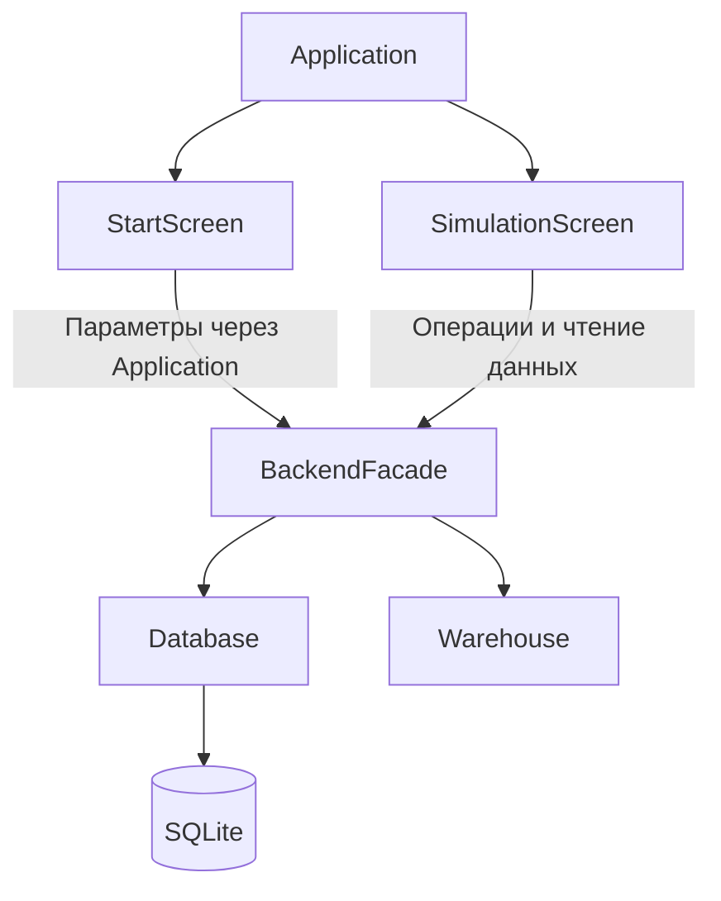

# Nova Warehouse

**Настольный симулятор оптового склада на C++ с графическим интерфейсом и SQLite.**

Проект моделирует снабжение магазинов: продажи покупателям уменьшают остатки, магазины оформляют заказы, склад резервирует партии и выполняет доставки, а поставщик пополняет запас. Сроки годности, уценка и списания влияют на финансовый результат.

Пользователь может менять спрос, начальную заполненность, запас в днях и закупочную цену, чтобы сравнивать складские стратегии.

README описывает версию с параметрами эксперимента, обновлённым интерфейсом и кнопкой **«Новый сценарий»**.

## Содержание

- [Возможности](#возможности)
- [Технологии](#технологии)
- [Сборка и запуск](#сборка-и-запуск)
- [Управление](#управление)
- [Настройки эксперимента](#настройки-эксперимента)
- [Как работает модель](#как-работает-модель)
- [Экономика](#экономика)
- [Архитектура и исходники](#архитектура-и-исходники)
- [База данных](#база-данных)
- [Тестирование](#тестирование)
- [Решение проблем](#решение-проблем)
- [Ограничения модели](#ограничения-модели)

## Возможности

- До 9 магазинов и 20 видов товаров с заданными ассортиментами.
- Учёт доступных остатков, вместимости и размера упаковок.
- Партийный учёт со сроками годности и индивидуальными скидками.
- Резервирование под заказы с приоритетом ближайшего истечения срока — FEFO.
- Частичное выполнение заказов целыми упаковками.
- Заявки поставщикам с ручным или автоматическим подтверждением.
- Случайная задержка поставки от 1 до 5 дней.
- Автоматическая и ручная уценка подходящих партий.
- Списание просроченного товара и журнал операций.
- Карта склада, магазинов и транспорта; управление скоростью моделирования.
- Итоговый отчёт: выручка, закупочная стоимость доставок, списания и результат.
- График выручки и списаний по дням, таблица результатов по товарам.
- Возврат к параметрам для создания нового сценария.

## Технологии

| Компонент | Технология |
|---|---|
| Backend | C++17 |
| Графическое приложение | C++20 |
| Карта, окно, текстуры | SFML 3 |
| Кнопки, панели, таблицы | Dear ImGui 1.91.9 |
| Интеграция интерфейса | ImGui-SFML 3.0 |
| Хранение данных | SQLite |
| Система сборки | CMake, Ninja |
| Оформление C++ | `.clang-format` на основе Google Style |

Frontend и backend работают в одном процессе. Отдельный сервер, REST API или сетевое подключение к базе не требуются.

## Сборка и запуск

### Зависимости

Основной графический сценарий ориентирован на **Windows + MSYS2 UCRT64**.

Потребуются:

- GCC с поддержкой C++20;
- CMake версии 3.20 или новее;
- Ninja;
- SFML 3 с заголовками и библиотеками;
- SQLite с заголовками и библиотекой;
- Git и интернет для первой загрузки ImGui и ImGui-SFML через CMake FetchContent.

Команды ниже предполагают установку MSYS2 в `C:\msys64` и библиотеки UCRT64 в `C:\msys64\ucrt64`.

В `Application.cpp` используются Windows API и системный шрифт `C:/Windows/Fonts/arial.ttf`. Для переноса графического приложения на другую ОС эти места нужно адаптировать.

### Получение проекта

```powershell
git clone --branch work https://github.com/cloudly28-arch/NovaPochta_r.git
cd NovaPochta_r
```

Если проект скачан архивом, откройте терминал в его корне. В этой папке должны находиться `front` и `nova_poshta_warehouse_backend`.

### Настройка и сборка из PowerShell

```powershell
$env:Path = "C:\msys64\ucrt64\bin;" + $env:Path

cmake -S front -B front/build-local -G Ninja -DCMAKE_CXX_COMPILER=C:/msys64/ucrt64/bin/g++.exe -DCMAKE_PREFIX_PATH=C:/msys64/ucrt64 -DSFML_DIR=C:/msys64/ucrt64/lib/cmake/SFML

cmake --build front/build-local -j 4

.\front\build-local\NovaPoshtaWarehouseFrontend.exe
```

При первом конфигурировании CMake загружает закреплённые версии ImGui и ImGui-SFML.

### Повторный запуск

Если исходники не менялись:

```powershell
$env:Path = "C:\msys64\ucrt64\bin;" + $env:Path
.\front\build-local\NovaPoshtaWarehouseFrontend.exe
```

После изменения исходников сначала выполните:

```powershell
cmake --build front/build-local -j 4
```

Для **CMD** настройка `PATH` отличается:

```bat
set "PATH=C:\msys64\ucrt64\bin;%PATH%"
```

Остальные команды CMake можно использовать без изменений.

## Управление

1. Задайте параметры на стартовом экране.
2. Нажмите **«Запустить симуляцию»** — программа создаст эксперимент и откроет карту.
3. На карте нажмите **«Старт»**, чтобы включить течение времени.
4. Выбирайте склад, поставщика или магазин для просмотра данных.
5. Если выбран ручной режим, подтверждайте заявки в панели поставщика.
6. После завершения периода откройте итоговый отчёт.

| Элемент | Действие |
|---|---|
| Старт | Начать или продолжить моделирование; после завершённого периода — повторить эксперимент |
| Пауза | Приостановить течение времени |
| Сброс | Вернуться к первому дню с теми же параметрами и восстановленными начальными данными |
| Новый сценарий | Приостановить моделирование и вернуться к настройкам |
| 1× / 2× / 5× / 10× | Изменить скорость моделирования |
| Итоговый отчёт | Посмотреть результаты завершённого периода |

При переходе к новому сценарию предыдущие значения параметров сохраняются в форме. Текущая база заменяется после запуска нового эксперимента. Машины, выбор объектов и история отчёта подготавливаются заново.

Галочки **«Задать заполненность склада»** и **«Задать запас в днях»** показывают ползунки ручной настройки. Без галочек действует автоматический расчёт. Подробности параметров доступны при наведении.

## Настройки эксперимента

| Параметр | Диапазон | По умолчанию |
|---|---|---|
| Продолжительность | 10–100 дней | 20 дней |
| Магазины | 3–9 | 9 |
| Виды товаров | 12–20 | 20 |
| Спрос | 50–150% | 100% |
| Начальная заполненность | Автоматически или 0–100% | Автоматически |
| Запас | Автоматически или 1–14 дней | Автоматически |
| Закупочная цена | 1–100% обычной цены продажи | 70% |
| Подтверждение поставок | Вручную / автоматически | Вручную |

### Начальная заполненность

Ручной процент задаёт долю вместимости **каждой товарной позиции**, а не физического объёма здания. Количество округляется вниз до целых упаковок.

Например, при вместимости 100 единиц и упаковке по 12 даже заполненность 100% даст 96 единиц.

Настройка меняет только начальное состояние. Минимальный запас продолжает определяться спросом, поэтому пустой склад может сформировать заявки на пополнение.

### Спрос

100% соответствует базовым продажам магазинов, 150% — примерно в полтора раза большему ожидаемому потреблению при наличии товара. Настройка влияет и на продажи, и на прогноз потребности для пополнения.

### Запас в днях

Определяет целевой резерв для пополнения и участвует в расчёте начального автоматического запаса. Для скоропортящихся товаров резерв ограничивается сроком годности; также учитываются вместимость, нехватка магазинов и уже заказанные поставки.

В автоматическом режиме ориентир составляет до 3 дней для товаров со сроком до 7 дней, 5 дней для срока до 30 дней и 7 дней для более длительных сроков. Для коротких сроков дополнительно действует ограничение по оставшемуся времени годности.

### Закупочная цена

Единый для эксперимента процент от обычной цены продажи. При значении 70% товар с обычной ценой 100 рублей закупается по модели за 70 рублей.

В `ExperimentSettings` значение `initialFillPercent = -1` означает автоматическую заполненность, а `stockCoverDays = 0` — автоматический резерв. Backend проверяет диапазоны независимо от интерфейса.

## Как работает модель

### Продажи магазинов

День разбит на восемь трёхчасовых интервалов. Для позиции магазина базовое случайное потребление за интервал — одна или две единицы, в среднем 12 единиц за день при наличии товара.

Интенсивность спроса масштабирует потребление. Дробная часть округляется вероятностно без систематического завышения. Фактические продажи ограничены остатком магазина.

### Заказы и партии

Магазин формирует заказ при снижении остатка до минимального уровня; наличие скидочной партии также может включить позицию в кандидаты. Объём ориентирован примерно на половину вместимости с вариацией ±8% и приводится к упаковкам.

Склад ограничивает выделение:

- ещё не выполненной частью запроса;
- доступным запасом, пригодным на плановый день доставки;
- свободным местом магазина;
- размером целой упаковки.

Партии выбираются по ближайшему сроку годности. Выделенный товар исключается из доступного остатка и связывается с заказом через `warehouse_allocations`.

`Allocated` означает, что выделен хотя бы какой-то товар. `Completed` означает завершение доставки выделенного количества; заказ мог быть выполнен частично.

### Поставки

Заявка поставщику проходит состояния:

**`Created` → `InTransit` → `Delivered`.**

После подтверждения отсчитывается задержка 1–5 дней. Уже созданные и отправленные заявки учитываются при планировании новых. Получение поставки увеличивает остаток и создаёт новую партию.

### Уценка и списания

Партия годна, пока `expiresDay > currentDay`.

- За два дня до истечения автоматическая уценка повышает скидку до 15%, если текущая меньше.
- За один день — до 30%.
- Ручная скидка 0–90% доступна для непустой партии в последние три дня годности.
- При `expiresDay <= currentDay` доступный остаток партии списывается.

Партийный учёт сроков действует на складе. В магазинах хранятся суммарные остатки без отдельного списания магазинных партий по сроку.

## Экономика

### Что является продажей

Финансовая граница модели — **склад как оптовый продавец магазинам**.

Выручка признаётся по доставкам со статусом `Completed`. Резерв или незавершённый заказ ещё не является продажей. Продажи магазинов конечным покупателям уменьшают их остатки, но не добавляются второй раз к выручке склада.

### Основная формула

```text
Результат = Выручка
          − Закупочная стоимость доставленных товаров
          − Закупочная стоимость списаний
```

Это валовой результат в рамках учтённых статей, а не чистая прибыль и не денежный поток. Транспорт, зарплаты, хранение, налоги и график платежей не моделируются.

### Цена единицы и округление

Деньги рассчитываются в целых копейках, итоговые суммы хранятся в 64-битных полях.

Пусть `P` — обычная цена в копейках, `k` — закупочная доля, `d` — скидка:

```text
Себестоимость единицы = (P × k + 50) / 100
Цена продажи единицы = (P × (100 − d) + 50) / 100
```

Здесь используется целочисленное деление: `+50` округляет положительный результат до ближайшей копейки. Сначала округляется цена единицы, затем она умножается на количество.

Пример: `P = 10001` копейка, `k = 70%`. Себестоимость единицы — `7001` копейка, десяти единиц — `70010` копеек.

Цена закупки считается от **обычной**, а не от уценённой цены: скидка покупателю не уменьшает первоначальную себестоимость.

### Почему уценка не вычитается повторно

Обычная цена 100 рублей и скидка 15% дают выручку 85 рублей за единицу. Разница 15 рублей показывается как справочное снижение выручки.

Фактическая выручка уже уменьшена. Если ещё раз вычесть из неё величину уценки, одна скидка будет учтена дважды.

### Почему не вычитаются сразу все поставки

Полученный, но ещё не проданный товар остаётся запасом. Его закупочная стоимость попадает в расход модели после завершённой доставки или списания.

Резерв также не включается в себестоимость продаж до завершения доставки. Доступный остаток и резерв показаны отдельно: зарезервированный товар уже исключён из доступного количества склада.

### Числовой пример

Условный товар продаётся по 100 рублей, закупается по 70 рублей. Размер упаковки для примера — одна единица. Изначально на складе 100 единиц.

| Операция | Количество | Выручка, руб. | Себестоимость / потеря, руб. |
|---|---:|---:|---:|
| Доставлено без скидки | 60 | 6 000 | 4 200 |
| Доставлено со скидкой 30% | 20 | 1 400 | 1 400 |
| Списано | 10 | 0 | 700 |
| Осталось, включая возможный резерв | 10 | 0 | Не списывается в расход |

```text
Выручка:                 6 000 + 1 400 = 7 400 руб.
Себестоимость доставок:  4 200 + 1 400 = 5 600 руб.
Себестоимость списаний:       10 × 70 =   700 руб.
Результат:               7 400 − 5 600 − 700 = 1 100 руб.
```

Справочная уценка равна `20 × (100 − 70) = 600` рублей. Повторно вычитать её из результата не нужно.

Если предположить, что все 100 единиц были оплачены в этом же периоде, а все доставки сразу оплачены магазинами, денежный поток составил бы `7400 − 7000 = 400` рублей. Разница с результатом равна стоимости оставшегося запаса — 700 рублей. Сам денежный поток программа отдельно не рассчитывает.

### Показатели отчёта в коде

| Поле | Значение |
|---|---|
| `revenueCents` | Выручка завершённых доставок |
| `deliveredCostCents` | Закупочная стоимость доставленного |
| `writeoffCostCents` | Закупочная стоимость списанного |
| `discountLossCents` | Справочное снижение выручки из-за скидок |
| `writeoffLossCents` | Справочная стоимость списанного по обычной цене |

Для результата используется `revenueCents − deliveredCostCents − writeoffCostCents`. Поле `writeoffLossCents` не подменяет себестоимость списаний.

График по дням показывает выручку и себестоимость списаний. Он не является графиком прибыли: себестоимость доставок на нём отдельно не вычитается.

## Архитектура и исходники



| Путь | Назначение |
|---|---|
| `front/src/main.cpp` | Точка входа графического приложения |
| `front/src/Application.cpp` | Окно, события, подключение backend, переключение экранов и тема |
| `front/src/ui/StartScreen.cpp` | Параметры сценария и запуск |
| `front/src/ui/SimulationScreen.cpp` | Время, карта, транспорт, панели и отчёт |
| `front/include/ui/StartScreen.h` | Структура `SimulationSettings` |
| `nova_poshta_warehouse_backend/include/domain/ExperimentSettings.h` | Настройки модели и проверка диапазонов |
| `nova_poshta_warehouse_backend/src/application/BackendFacade.cpp` | Продажи, заказы, пополнение, доставка и уценка |
| `nova_poshta_warehouse_backend/src/persistence/Database.cpp` | SQLite, транзакции, партии, журналы и расчёт отчёта |
| `nova_poshta_warehouse_backend/database/schema.sql` | Исходная структура и данные |
| `nova_poshta_warehouse_backend/include/domain/` | Объекты предметной области |
| `nova_poshta_warehouse_backend/src/services/` | Сервисы объектного слоя |
| `nova_poshta_warehouse_backend/src/main.cpp` | Отдельная консольная программа backend |
| `nova_poshta_warehouse_backend/tests/experiment_settings_test.cpp` | Регрессионные тесты |

Основной графический путь выполнения — `SimulationScreen → BackendFacade → Database`. `InventoryService`, `OrderService` и `TaskService` относятся к отдельному объектному слою; их наличие не означает, что они управляют всеми операциями на карте.

Графический ход времени реализован преимущественно в `SimulationScreen`, а не только в `SimulationService`. Доступные остатки читаются из SQLite; загруженный в память `Warehouse` не следует считать автоматически синхронизированной копией всех текущих данных.

## База данных

| Таблица | Данные |
|---|---|
| `stores`, `products` | Справочники |
| `store_inventory` | Ассортимент, остатки и вместимость магазинов |
| `warehouse_inventory` | Доступные складские остатки и вместимость |
| `warehouse_batches` | Партии, сроки, цены и скидки |
| `orders`, `order_items` | Заказы, запрошенные и выделенные количества |
| `warehouse_allocations` | Выделение из партий с зафиксированными ценами |
| `supplier_requests` | Заявки поставщикам |
| `warehouse_writeoffs` | Журнал списаний |
| `experiment_settings` | Настройки текущего эксперимента |

При резервировании, приёмке и списании используются транзакции и точки сохранения `SAVEPOINT`. При ошибке связанные изменения откатываются.

Отчёт агрегирует доставки, резервы, списания и остатки отдельно, затем соединяет результаты по товарам. Это предотвращает повторное суммирование при соединении нескольких журналов.

База и ресурсы находятся рядом с исполняемым файлом:

- `database/nova_poshta_warehouse.db`;
- `database/schema.sql`;
- `assets/`.

CMake копирует ресурсы и SQL-схему при сборке. Новая база подготавливается по схеме во временной базе в памяти и переносится в рабочий файл.

**Новый эксперимент пересоздаёт данные текущего эксперимента.** Это не система нескольких независимых сохранений.

Таблица `experiment_settings` добавляется автоматически, если отсутствует. В старой базе применяются настройки по умолчанию; для сравнения результатов после обновления экономики следует начать новый эксперимент.

## Тестирование

Тесты по умолчанию выключены. Для отдельной сборки backend из PowerShell:

```powershell
$env:Path = "C:\msys64\ucrt64\bin;" + $env:Path

cmake -S nova_poshta_warehouse_backend -B backend-tests -G Ninja -DCMAKE_CXX_COMPILER=C:/msys64/ucrt64/bin/g++.exe -DCMAKE_PREFIX_PATH=C:/msys64/ucrt64 -DNOVA_BUILD_TESTS=ON

cmake --build backend-tests -j 4
ctest --test-dir backend-tests --output-on-failure
```

Используется отдельная тестовая база в каталоге сборки.

Регрессионные проверки охватывают:

- заполненность 0%, 50%, 100% и автоматический расчёт;
- целые упаковки, вместимость и согласованность партий с остатками;
- сохранение настроек после открытия базы и повторного эксперимента;
- отклонение некорректных параметров;
- изменение продаж при спросе 50%, 100%, 150%;
- влияние дней резерва на начальный запас и заявки;
- округление себестоимости и учёт скидок;
- исключение незавершённых доставок из выручки и себестоимости продаж;
- совместимость базы без таблицы настроек;
- прогоны на 10 и 30 дней, включая пустой склад при высоком спросе и полный склад при низком спросе.

Headless-проверки backend пройдены. Для интерфейса проверялись синтаксис и компоновка отдельных экранов. Это не заменяет полный интерактивный прогон графического приложения под Windows.

## Решение проблем

### `domain/ExperimentSettings.h: No such file or directory`

Проверьте наличие файла:

```text
nova_poshta_warehouse_backend/include/domain/ExperimentSettings.h
```

Он обязателен для версии с новыми настройками. При переносе обновления нужно копировать новые заголовки вместе с изменёнными `.cpp` и `.h`.

### Компилятор завершается без понятного сообщения

В текущем PowerShell восстановите путь к UCRT64 и запустите сборку последовательно:

```powershell
$env:Path = "C:\msys64\ucrt64\bin;" + $env:Path
cmake --build front/build-local -j 1 --verbose
```

По одному слову `FAILED` точную причину определить нельзя: нужен вывод компилятора.

### CMake не находит SFML или SQLite

Проверьте установку заголовков и библиотек именно для UCRT64, а также пути `CMAKE_PREFIX_PATH` и `SFML_DIR`. Нельзя подставлять несовместимые библиотеки другого компилятора вместо UCRT64.

### Проблема после смены компилятора или переноса сборки

Заново выполните команду конфигурирования с `cmake --fresh -S front ...`, указав остальные параметры из раздела сборки. `--fresh` очищает кэш конфигурации, но не устанавливает отсутствующие зависимости.

### Текстуры, база или кириллица не загружаются

Проверьте наличие `assets` и `database/schema.sql` рядом с `.exe`, права записи в папку базы и доступность шрифта Arial по пути, указанному в `Application.cpp`.

## Ограничения модели

- Скидка влияет на фактическую цену и попадание позиции в кандидаты заказа. Рассчитанные `candidateWeights` пока не используются для взвешенного случайного выбора: нельзя считать рост вероятности выбора от каждого увеличения скидки завершённой функцией.
- Завершение доставок и запуск рейсов в графическом режиме связаны с анимацией и обновлением интерфейса. Независимость результатов от скорости 1×/10× отдельно не доказана.
- Часть обработчиков фасада возвращает `void`; не все ошибки автоматически останавливают моделирование.
- Запрос магазина уже формируется в упаковках. Произвольный исходный запрос в штуках не моделируется отдельно в полном объёме.
- При сокращении числа магазинов или товаров выбираются первые записи по ID; отдельного редактора ассортимента нет.
- `schema.sql` создаёт новую базу, а не выполняет универсальное обновление любой старой структуры.
- Модель не учитывает магазинную просрочку, реальные вместимости машин, дорожную обстановку, операционные расходы и платежи.

Проект предназначен для учебных экспериментов: сравнения стратегий запаса, наблюдения за дефицитом и списаниями и объяснения финансового результата через конкретные операции.
